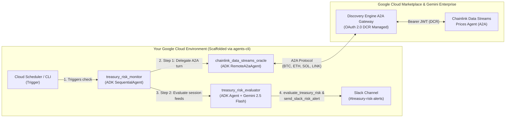

# Giving Your AI Agent a Price Oracle: Building an Autonomous Multi-Agent Treasury Risk Monitor with Chainlink Data Streams and Google Cloud

*By Deep Chenna, Web3 Customer Engineer, Google Cloud*

> **📦 Code & Step-by-Step Guide:** The complete working codebase and step-by-step setup guide are available on GitHub at [**github.com/deepchenna/chainlink-treasury-monitor**](https://github.com/deepchenna/chainlink-treasury-monitor).

---

Previously, we explored how combining Google Cloud’s generative AI with Chainlink’s decentralized oracle infrastructure unlocks hybrid Web3 applications—from [creating generative art dynamic NFTs with Vertex AI and Chainlink Functions](https://medium.com/google-cloud/creating-generative-art-dynamic-nfts-with-google-cloud-vertex-ai-and-chainlink-functions-db762cd35290) to building an [AI-powered prediction market with the Chainlink Runtime Environment (CRE) and Google Gemini](https://medium.com/google-cloud/ai-powered-prediction-market-with-chainlink-runtime-environment-cre-and-google-gemini-5e114e487a8a).

In those architectures, **smart contracts** were the primary consumers of off-chain AI and data. Today, we are witnessing a major shift: **autonomous AI agents** are becoming first-class economic actors that monitor portfolios, manage liquidity, and coordinate treasury operations across on-chain and enterprise systems.

However, giving an AI agent responsibility over financial workflows introduces a fundamental problem: **LLMs do not have native access to verifiable, real-time market prices.**

* **Model knowledge cutoffs** mean an LLM has no idea what Bitcoin or Ethereum is trading at right now.
* **Standard web search grounding** is built for text discovery, not sub-second financial telemetry—it can scrape delayed articles, cached aggregators, or inconsistent tickers.
* **Custom oracle integrations** require maintaining persistent WebSocket connections and decoding fixed-point `1e18` cryptographic reports just to answer *"What is the price of ETH right now?"*

With the launch of the [**Chainlink Data Streams Price Agent on Google Cloud Marketplace**](https://console.cloud.google.com/marketplace/product/chainlink-labs-ltd-public/chainlink-data-streams-prices-agent), you can connect your AI agents directly to Chainlink’s institutional-grade, low-latency market data using the open **Agent-to-Agent (A2A)** protocol.

Let’s look at how to scaffold an **Autonomous Multi-Agent Treasury Risk Monitor** using Google’s **`agents-cli`** and **Agent Development Kit (ADK)**—where our local risk-evaluator agent collaborates directly with the remote **Chainlink Data Streams Price Agent** over A2A and dispatches automated incident alerts to **Slack**.

---

## Why Give Your AI Agent a Price Oracle Over A2A?

Just as DeFi smart contracts rely on price oracles to calculate collateral ratios safely, enterprise and Web3 AI agents need a single source of truth for market valuation:

1. **Sub-Second, Tamper-Proof Market Data:** Aggregates liquidity across leading exchanges with cryptographic provenance for major pairs (`BTC/USD`, `ETH/USD`, `SOL/USD`, and `LINK/USD`).
2. **Built-In Freshness Guardrails:** Every price tick includes a unix `timestamp` and an explicit `stale` boolean flag so your agent never acts on outdated data.
3. **True Multi-Agent Interoperability:** Instead of writing custom price-fetching tools, ADK's `RemoteA2aAgent` discovers the Chainlink agent via its `.well-known/agent.json` card (`https://<YOUR_CHAINLINK_A2A_AGENT_URL>/.well-known/agent.json`) and plugs it directly into a multi-agent workflow alongside your local Gemini risk-evaluation agent.

---

## Multi-Agent Architecture: The Autonomous Treasury Risk Monitor

Consider a Web3 protocol or institution managing a multi-asset treasury reserve (`85 BTC`, `1,200 ETH`, `8,500 SOL`, and `45,000 LINK`) subject to strict asset price floors, a `$10,000,000` minimum reserve threshold, and oracle freshness guardrails.

Rather than wrapping price lookups inside a traditional tool function, we model the system as a **two-stage ADK `SequentialAgent` pipeline**:



1. **Stage 1 — `chainlink_data_streams_oracle` (`RemoteA2aAgent`):** Invokes the remote **Chainlink Data Streams Price Agent** over A2A and writes the verified `BTC/USD`, `ETH/USD`, `SOL/USD`, and `LINK/USD` feed snapshot (`pair`, `price`, `timestamp`, `stale`) into the shared ADK session.
2. **Stage 2 — `treasury_risk_evaluator` (`Agent`):** Powered by **Gemini 2.5 Flash**, reads the oracle feed snapshot emitted by `chainlink_data_streams_oracle` from the session context, runs deterministic portfolio math (`evaluate_treasury_risk`), and dispatches a rich Block Kit incident alert to Slack (`send_slack_risk_alert`) whenever a floor or freshness invariant is breached.

---

## Key Implementation Highlights

### 1. Scaffold the ADK Project with `agents-cli`

Using Google's `agents-cli`, we scaffold a Cloud Run-ready ADK project in a single command:

```bash
agents-cli scaffold create chainlink-treasury-monitor \
  --agent adk \
  --deployment-target cloud_run \
  --region us-central1 \
  --prototype
```

### 2. Multi-Agent Orchestration with `RemoteA2aAgent` & `SequentialAgent` (`app/agent.py`)

In `app/agent.py`, we wire the remote **Chainlink Data Streams Price Agent** (`RemoteA2aAgent`) and our local **Treasury Risk Evaluator** (`Agent`) into an ADK `SequentialAgent` pipeline:

```python
from google.adk.agents import Agent, SequentialAgent
from google.adk.agents.remote_a2a_agent import AGENT_CARD_WELL_KNOWN_PATH, RemoteA2aAgent
from google.adk.apps import App
from google.adk.models import Gemini
from .a2a_client import create_chainlink_a2a_httpx_client
from .tools import evaluate_treasury_risk, send_slack_risk_alert

chainlink_a2a_url = os.environ.get(
    "CHAINLINK_A2A_URL", "https://<YOUR_CHAINLINK_A2A_AGENT_URL>"
).rstrip("/")

# 1. Remote A2A Agent: Official Chainlink Data Streams Price Agent
chainlink_price_oracle_agent = RemoteA2aAgent(
    name="chainlink_data_streams_oracle",
    description=(
        "Official Chainlink Data Streams A2A Agent providing low-latency spot prices "
        "for BTC/USD, ETH/USD, SOL/USD, and LINK/USD."
    ),
    agent_card=f"{chainlink_a2a_url}{AGENT_CARD_WELL_KNOWN_PATH}",
    httpx_client=create_chainlink_a2a_httpx_client(),
)

# 2. Local ADK Agent: Treasury Risk Evaluator & Slack Incident Responder
treasury_risk_evaluator_agent = Agent(
    name="treasury_risk_evaluator",
    model=Gemini(model="gemini-2.5-flash"),
    instruction=RISK_EVALUATOR_INSTRUCTION,
    tools=[evaluate_treasury_risk, send_slack_risk_alert],
)

# 3. Multi-Agent Pipeline: Chainlink Data Streams A2A Agent -> Treasury Risk Evaluator Agent
root_agent = SequentialAgent(
    name="treasury_risk_monitor",
    description="Autonomous multi-agent treasury risk monitor.",
    sub_agents=[
        chainlink_price_oracle_agent,
        treasury_risk_evaluator_agent,
    ],
)

app = App(root_agent=root_agent, name="app")
```

### 3. Deterministic Risk Evaluation & Slack Alerting (`app/tools.py`)

Because `chainlink_data_streams_oracle` handles all A2A price discovery directly as a sub-agent, `app/tools.py` stays focused purely on deterministic portfolio math (`evaluate_treasury_risk`) and Slack Block Kit incident delivery (`send_slack_risk_alert`):

```python
def evaluate_treasury_risk(feeds: list[dict]) -> dict:
    """Evaluates live Chainlink prices from the A2A sub-agent against treasury risk floors."""
    total_usd_value = 0.0
    breaches = []
    price_map = {item["pair"]: item for item in feeds}

    for pair, config in TREASURY_CONFIG["positions"].items():
        feed = price_map.get(pair)
        if feed.get("stale", False):
            breaches.append(
                f"STALE_ORACLE_DATA: {pair} tick at timestamp {feed.get('timestamp')} is marked stale (>10s old)."
            )

        spot_price = float(feed["price"])
        total_usd_value += spot_price * config["units"]
        if spot_price < config["price_floor"]:
            drawdown_pct = ((config["price_floor"] - spot_price) / config["price_floor"]) * 100
            breaches.append(
                f"PRICE_FLOOR_BREACH: {pair} spot price (${spot_price:,.2f}) breached risk floor "
                f"(${config['price_floor']:,.2f}) by -{drawdown_pct:.2f}%."
            )

    return {
        "status": "BREACH_DETECTED" if breaches else "HEALTHY",
        "total_portfolio_usd": round(total_usd_value, 2),
        "breaches": breaches,
    }
```

---

## Live Multi-Agent Execution Output

Running the pipeline with `agents-cli run` executes `[chainlink_data_streams_oracle]` first over A2A against the live Chainlink Data Streams Agent on Google Cloud Marketplace, hands the verified prices to `[treasury_risk_evaluator]`, and dispatches a structured Slack Block Kit alert:

```bash
$ agents-cli run "Run an immediate treasury risk check across BTC/USD, ETH/USD, SOL/USD, and LINK/USD."

[user]: Run an immediate treasury risk check across BTC/USD, ETH/USD, SOL/USD, and LINK/USD.
[chainlink_data_streams_oracle]: {
  "status": "success",
  "source": "Chainlink Data Streams A2A Agent",
  "updated_label": "Updated 10:04:27 UTC",
  "feeds": [
    {"pair": "BTC/USD",  "price": 81477.89, "timestamp": 1793009069, "stale": true},
    {"pair": "ETH/USD",  "price": 2392.73,  "timestamp": 1793009069, "stale": true},
    {"pair": "SOL/USD",  "price": 103.83,   "timestamp": 1793009069, "stale": true},
    {"pair": "LINK/USD", "price": 12.07,    "timestamp": 1793009069, "stale": true}
  ]
}
[treasury_risk_evaluator]:
  [tool_call: evaluate_treasury_risk({"feeds": [...]})]
  [tool_response: evaluate_treasury_risk -> {"status": "BREACH_DETECTED", "total_portfolio_usd": 11222601.65, "breach_count": 7}]
  [tool_call: send_slack_risk_alert({"severity": "CRITICAL", "headline": "Treasury Risk Alert: Multiple Price Floor Breaches and Stale Oracle Data Detected", ...})]
  [tool_response: send_slack_risk_alert -> {"status": "sent", "http_status": 200}]
```

---

## Try It Yourself

Ready to build and deploy your own autonomous multi-agent treasury monitor on Cloud Run?

👉 **Clone the repository and follow the step-by-step setup guide on GitHub:**
[**https://github.com/deepchenna/chainlink-treasury-monitor**](https://github.com/deepchenna/chainlink-treasury-monitor)

The repository [`README.md`](https://github.com/deepchenna/chainlink-treasury-monitor#readme) includes full instructions for:
1. Subscribing to the [**Chainlink Data Streams Price Agent on Google Cloud Marketplace**](https://console.cloud.google.com/marketplace/product/chainlink-labs-ltd-public/chainlink-data-streams-prices-agent) and registering it in Gemini Enterprise (where Google Cloud manages OAuth 2.0 DCR automatically).
2. Running the multi-agent pipeline locally via `agents-cli run` and the interactive `adk web` UI.
3. Deploying to **Cloud Run** (`agents-cli deploy`) with automated **Cloud Scheduler** triggers.
