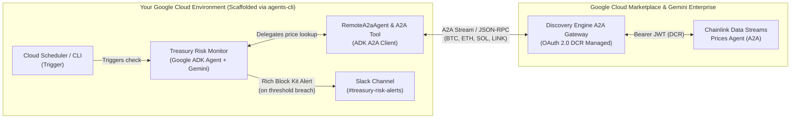

# Giving Your AI Agent a Price Oracle: Building an Autonomous Treasury Risk Monitor with Chainlink Data Streams and Google Cloud

*By Deep Chenna, Web3 Customer Engineer, Google Cloud*

> **📦 Code & Step-by-Step Guide:** The complete working codebase and step-by-step setup guide are available on GitHub at [**github.com/deepchenna/chainlink-treasury-monitor**](https://github.com/deepchenna/chainlink-treasury-monitor).

---

Previously, we explored how combining Google Cloud’s generative AI with Chainlink’s decentralized oracle infrastructure unlocks hybrid Web3 applications—from [creating generative art dynamic NFTs with Vertex AI and Chainlink Functions](https://medium.com/google-cloud/creating-generative-art-dynamic-nfts-with-google-cloud-vertex-ai-and-chainlink-functions-db762cd35290) to building an [AI-powered prediction market with the Chainlink Runtime Environment (CRE) and Google Gemini](https://medium.com/google-cloud/ai-powered-prediction-market-with-chainlink-runtime-environment-cre-and-google-gemini-5e114e487a8a).

In those architectures, **smart contracts** were the primary consumers of off-chain AI and data. Today, we are witnessing a major shift: **autonomous AI agents** are becoming first-class economic actors that monitor portfolios, manage liquidity, and coordinate treasury operations across on-chain and enterprise systems.

However, giving an AI agent responsibility over financial workflows introduces a fundamental problem: **LLMs do not have native access to verifiable, real-time market prices.**

* **Model knowledge cutoffs** mean an LLM has no idea what Bitcoin or Ethereum is trading at right now.
* **Standard web search grounding** is built for text discovery, not sub-second financial telemetry—it can scrape delayed articles, cached aggregators, or inconsistent tickers.
* **Custom oracle integrations** require maintaining persistent WebSocket connections and decoding fixed-point `1e18` cryptographic reports just to answer *"What is the price of ETH right now?"*

With the launch of the [**Chainlink Data Streams Price Agent on Google Cloud Marketplace**](https://console.cloud.google.com/marketplace/product/chainlink-labs-ltd-public/chainlink-data-streams-prices-agent), you can connect your AI agents directly to Chainlink’s institutional-grade, low-latency market data using the open **Agent-to-Agent (A2A)** protocol.

Let’s look at how to scaffold an **Autonomous Treasury Risk Monitor** using Google’s **`agents-cli`** and **Agent Development Kit (ADK)** that consumes live Chainlink prices over A2A and dispatches automated incident alerts to **Slack**.

---

## Why Give Your AI Agent a Price Oracle Over A2A?

Just as DeFi smart contracts rely on price oracles to calculate collateral ratios safely, enterprise and Web3 AI agents need a single source of truth for market valuation:

1. **Sub-Second, Tamper-Proof Market Data:** Aggregates liquidity across leading exchanges with cryptographic provenance for major pairs (`BTC/USD`, `ETH/USD`, `SOL/USD`, and `LINK/USD`).
2. **Built-In Freshness Guardrails:** Every price tick includes a unix `timestamp` and an explicit `stale` boolean flag so your agent never acts on outdated data.
3. **Standardized A2A Interoperability:** Your ADK agent discovers the Chainlink agent via its `.well-known/agent.json` card (`https://<YOUR_CHAINLINK_A2A_AGENT_URL>/.well-known/agent.json`) and communicates over standard A2A and OAuth 2.0 Dynamic Client Registration (DCR) managed by **Gemini Enterprise**.

---

## Architecture: The Autonomous Treasury Risk Monitor

Consider a Web3 protocol or institution managing a multi-asset treasury reserve (`15 BTC`, `250 ETH`, `5,000 SOL`, `25,000 LINK`, and `500,000 USDC`) alongside a DeFi credit vault collateralized by `400 ETH` against `$600,000 USDC` in debt.



The agent enforces four strict risk invariants on every check:
1. **Oracle Freshness:** `stale == false` across all feeds.
2. **Total Reserve Floor:** Total treasury value must stay above **$2,650,000 USD**.
3. **Asset Price Floors:** `BTC >= $72,000`, `ETH >= $2,300`, `SOL >= $88`, `LINK >= $9.50`.
4. **DeFi Collateral Health Factor:** The ETH vault health factor $\left(\frac{\text{Collateral Value} \times 0.80}{\text{Debt}}\right)$ must stay above **1.65x**.

---

## Key Implementation Highlights

### 1. Scaffold the ADK Project with `agents-cli`

Using Google's `agents-cli`, we scaffold a Cloud Run-ready ADK project in a single command:

```bash
agents-cli scaffold create treasury-risk-monitor \
  --agent adk \
  --deployment-target cloud_run \
  --region us-central1 \
  --prototype
```

### 2. Query the Chainlink Data Streams Agent via A2A (`app/tools.py`)

When you subscribe to the Chainlink agent on Google Cloud Marketplace and register it in **Gemini Enterprise**, Discovery Engine automatically handles **OAuth 2.0 Dynamic Client Registration (DCR)** (`POST /dcr`) and token refresh (`POST /oauth/token`).

Our A2A tool invokes the Chainlink agent’s `render_price_ui` (or `stream_prices`) skill and extracts the verified `application/json+a2ui` price ticks and freshness flags:

```python
def fetch_chainlink_oracle_prices(
    feeds: list[str] | None = None,
) -> dict[str, Any]:
    """Queries the Chainlink Data Streams A2A Agent for real-time prices."""
    target_feeds = feeds or ["BTC/USD", "ETH/USD", "SOL/USD", "LINK/USD"]
    a2a_url = os.getenv(
        "CHAINLINK_A2A_URL",
        "https://<YOUR_CHAINLINK_A2A_AGENT_URL>",
    ).rstrip("/")
    skill_id = os.getenv("CHAINLINK_SKILL_ID", "render_price_ui")

    # Supports both Gemini Enterprise DCR Gateway and direct A2A JSON-RPC 2.0
    discovery_agent = os.getenv("DISCOVERY_ENGINE_A2A_AGENT")
    if discovery_agent:
        return _fetch_via_discovery_engine_a2a(discovery_agent, target_feeds, skill_id)

    rpc_request = {
        "jsonrpc": "2.0",
        "id": str(uuid.uuid4()),
        "method": "message/send",
        "params": {
            "message": {
                "role": "user",
                "messageId": str(uuid.uuid4()),
                "parts": [
                    {
                        "kind": "text",
                        "text": json.dumps({"skill_id": skill_id, "feeds": target_feeds}),
                    }
                ],
            }
        },
    }
    with httpx.Client(timeout=20.0) as client:
        resp = client.post(f"{a2a_url}/", json=rpc_request, headers=_get_headers())
        resp.raise_for_status()
        return _extract_feeds_from_rpc(resp.json())
```

### 3. Deterministic Risk Evaluation (`app/tools.py`)

Financial agents should **never** rely on LLM token prediction for portfolio math. Instead, `evaluate_treasury_risk` computes exact valuations, drawdown percentages, and the DeFi vault health factor in Python, while leaving quantitative incident synthesis to Gemini:

```python
def evaluate_treasury_risk(feeds: list[dict[str, Any]]) -> dict[str, Any]:
    """Evaluates live Chainlink prices against treasury floors and vault health."""
    breaches: list[str] = []
    stale_feeds = [f["feed"] for f in feeds if f.get("stale", False)]
    if stale_feeds:
        breaches.append(
            f"CRITICAL ORACLE STALENESS: Feeds {stale_feeds} reported stale=True. "
            "Halt automated treasury execution immediately."
        )

    # Calculate asset valuations, price floor drawdowns, and ETH vault health factor
    eth_price = float(feed_map["ETH/USD"]["price"])
    collateral_usd = VAULT_POSITION["collateral_eth"] * eth_price
    health_factor = (
        collateral_usd * VAULT_POSITION["liquidation_threshold"]
    ) / VAULT_POSITION["debt_usdc"]

    if health_factor < VAULT_POSITION["min_safe_health_factor"]:
        breaches.append(
            f"VAULT COLLATERAL RISK: ETH Vault Health Factor is {health_factor:.2f}x "
            f"(below safe minimum {VAULT_POSITION['min_safe_health_factor']:.2f}x)."
        )

    return {
        "status": "BREACH_DETECTED" if breaches else "HEALTHY",
        "vault_health_factor": round(health_factor, 2),
        "breaches": breaches,
    }
```

### 4. Wire the ADK Orchestrator & `RemoteA2aAgent` (`app/agent.py`)

Finally, we combine our deterministic tools and ADK’s native `RemoteA2aAgent` inside `app/agent.py`:

```python
from google.adk.agents import Agent
from google.adk.agents.remote_a2a_agent import AGENT_CARD_WELL_KNOWN_PATH, RemoteA2aAgent
from google.adk.apps import App
from google.adk.models import Gemini
from .tools import evaluate_treasury_risk, fetch_chainlink_oracle_prices, send_slack_risk_alert

chainlink_a2a_url = os.environ.get(
    "CHAINLINK_A2A_URL", "https://<YOUR_CHAINLINK_A2A_AGENT_URL>"
).rstrip("/")

chainlink_price_oracle_subagent = RemoteA2aAgent(
    name="chainlink_data_streams_oracle",
    description="Official Chainlink Data Streams A2A Agent for BTC, ETH, SOL, and LINK.",
    agent_card=f"{chainlink_a2a_url}{AGENT_CARD_WELL_KNOWN_PATH}",
)

root_agent = Agent(
    name="treasury_risk_monitor",
    model=Gemini(model="gemini-2.5-flash"),
    instruction=RISK_MONITOR_INSTRUCTION,
    tools=[fetch_chainlink_oracle_prices, evaluate_treasury_risk, send_slack_risk_alert],
    sub_agents=[chainlink_price_oracle_subagent],
)

app = App(root_agent=root_agent, name="app")
```

---

## Live Execution Output

Running the agent with `agents-cli run` queries the live Chainlink Data Streams Agent on Google Cloud Marketplace, detects the ETH vault collateral breach (`1.26x < 1.65x`), and dispatches a structured Slack Block Kit alert:

```bash
$ agents-cli run "Run an immediate treasury risk check across BTC/USD, ETH/USD, SOL/USD, and LINK/USD."

  Tool Call: fetch_chainlink_oracle_prices(feeds=['BTC/USD', 'ETH/USD', 'SOL/USD', 'LINK/USD'])
  Tool Output: {
    "feeds": [
      {"feed": "BTC/USD",  "price": 75551.01,     "timestamp": 1776244260, "stale": false},
      {"feed": "ETH/USD",  "price": 2358.28,      "timestamp": 1776244260, "stale": false},
      {"feed": "SOL/USD",  "price": 91.74,        "timestamp": 1776244260, "stale": false},
      {"feed": "LINK/USD", "price": 9.5880550942, "timestamp": 1776244260, "stale": false}
    ]
  }
  Tool Call: evaluate_treasury_risk(...)
  Tool Output: {"status": "BREACH_DETECTED", "total_portfolio_usd": 2928575.69, "vault_health_factor": 1.26}
  Tool Call: send_slack_risk_alert(severity="CRITICAL", ...)
  Tool Output: {"sent": true, "http_status": 200}
```

---

## Try It Yourself

Ready to build and deploy your own autonomous treasury monitor on Cloud Run?

👉 **Clone the repository and follow the step-by-step setup guide on GitHub:**
[**https://github.com/deepchenna/chainlink-treasury-monitor**](https://github.com/deepchenna/chainlink-treasury-monitor)

The repository [`README.md`](https://github.com/deepchenna/chainlink-treasury-monitor#readme) includes full instructions for:
1. Subscribing to the [**Chainlink Data Streams Price Agent on Google Cloud Marketplace**](https://console.cloud.google.com/marketplace/product/chainlink-labs-ltd-public/chainlink-data-streams-prices-agent) and inspecting DCR credentials (`generate_dcr.py`).
2. Running the agent locally via `agents-cli run` and the interactive `adk web` UI.
3. Deploying to **Cloud Run** (`agents-cli deploy`) with automated **Cloud Scheduler** triggers.
