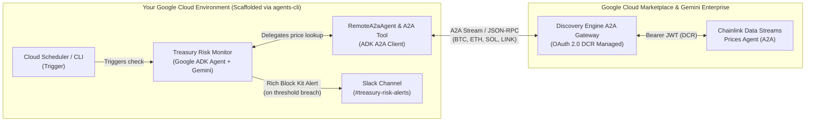

# Autonomous Treasury Risk Monitor (Chainlink Data Streams + Google Cloud ADK)

An autonomous crypto treasury risk monitoring agent built with **Google's Agent Development Kit (ADK)**, **Google `agents-cli`**, and **Gemini 2.5 Flash**, connected directly to the [**Chainlink Data Streams Price Agent on Google Cloud Marketplace**](https://console.cloud.google.com/marketplace/product/chainlink-labs-ltd-public/chainlink-data-streams-prices-agent) over the **Agent-to-Agent (A2A)** protocol.

---

## Architecture Overview



### Key Capabilities
* **Sub-Second Verifiable Market Data:** Fetches institutional-grade prices (`BTC/USD`, `ETH/USD`, `SOL/USD`, `LINK/USD`) from Chainlink Data Streams over A2A (`application/json+a2ui` and JSON-RPC 2.0).
* **Built-In Freshness Guardrails:** Inspects the unix `timestamp` and `stale` flag on every oracle tick before acting.
* **Deterministic Risk Invariants:** Evaluates total reserve valuation, asset price floors, and DeFi ETH vault collateral health factors (`>= 1.65x`) in pure Python (`evaluate_treasury_risk`) so the LLM never hallucinates arithmetic.
* **Automated Slack Block Kit Alerting:** Delivers quantitative incident alerts with AI-synthesized remediation steps to Slack (`send_slack_risk_alert`).

---

## Repository Structure

```text
chainlink-treasury-monitor/
├── app/
│   ├── agent.py                # Root ADK Agent + RemoteA2aAgent definition
│   ├── tools.py                # Chainlink A2A client, risk evaluator & Slack alerter
│   ├── fast_api_app.py         # FastAPI A2A & ADK server entrypoint
│   └── app_utils/              # A2A card, telemetry & typing utilities
├── deployment/                 # Terraform infrastructure templates for Cloud Run
├── tests/                      # Unit, integration & ADK evaluation datasets
├── agents-cli-manifest.yaml    # Google agents-cli project manifest
├── pyproject.toml              # Project dependencies (google-adk[a2a], httpx, etc.)
├── Dockerfile                  # Cloud Run production container
├── generate_dcr.py             # Helper CLI to inspect/exchange GCP Marketplace DCR credentials
├── mock_server.py              # Local Slack webhook receiver & mock A2A server for offline dev
├── .env.example                # Environment variable template
└── BLOG.md                     # Companion technical blog post
```

---

## Step-by-Step Setup Guide

### Prerequisites

* **Google Cloud Project** with billing enabled and the **Vertex AI API** & **Discovery Engine API** enabled.
* **Python 3.11+** and [`uv`](https://docs.astral.sh/uv/) installed.
* **`gcloud` CLI** authenticated (`gcloud auth login && gcloud auth application-default login`).
* **Subscription to the Chainlink Data Streams Prices Agent** on [Google Cloud Marketplace](https://console.cloud.google.com/marketplace/product/chainlink-labs-ltd-public/chainlink-data-streams-prices-agent).

---

### Step 1: Subscribe & Register the Chainlink Agent (DCR)

1. Subscribe to the [**Chainlink Data Streams Price Agent**](https://console.cloud.google.com/marketplace/product/chainlink-labs-ltd-public/chainlink-data-streams-prices-agent) in Google Cloud Marketplace.
2. Verify that the Marketplace entitlement and Agent Card (`https://<YOUR_CHAINLINK_A2A_AGENT_URL>/`) are visible in your project:

```bash
export PROJECT_ID="your-gcp-project-id"

curl -s -X GET \
  -H "Authorization: Bearer $(gcloud auth print-access-token)" \
  -H "X-Goog-User-Project: ${PROJECT_ID}" \
  "https://discoveryengine.googleapis.com/v1alpha/projects/${PROJECT_ID}/locations/global:fetchAgentCards" | jq .
```

3. In the **Google Cloud Console $\rightarrow$ Gemini Enterprise (Agentspace) $\rightarrow$ Agents**, register the **Chainlink Data Streams Agent** from your Marketplace procurement. Google Cloud's backend automatically executes RFC 7591 **Dynamic Client Registration (DCR)** (`POST /dcr`) against Chainlink's endpoint and stores the resulting OAuth 2.0 `client_id` and `client_secret` in Discovery Engine.
4. Inspect your active DCR authorization and Gemini Enterprise A2A Gateway endpoint using the included helper script:

```bash
python generate_dcr.py --inspect-gcp --project-id "${PROJECT_ID}"
```

This prints your `DISCOVERY_ENGINE_A2A_AGENT` resource path:
```text
projects/<PROJECT_NUMBER>/locations/global/collections/default_collection/engines/<ENGINE_ID>/assistants/default_assistant/agents/<AGENT_ID>
```

---

### Step 2: Install Dependencies & Configure Environment

Clone this repository and set up the virtual environment:

```bash
git clone https://github.com/deepchenna/chainlink-treasury-monitor.git
cd chainlink-treasury-monitor

uv venv .venv
source .venv/bin/activate
uv pip install google-agents-cli "google-adk[a2a]" google-genai httpx python-dotenv fastapi uvicorn google-cloud-iam
```

Copy `.env.example` to `.env`:

```bash
cp .env.example .env
```

Update `.env` with your project settings:

```dotenv
# Gemini / Vertex AI Configuration
GOOGLE_CLOUD_PROJECT=your-gcp-project-id
GOOGLE_CLOUD_LOCATION=us-central1
GOOGLE_GENAI_USE_VERTEXAI=TRUE

# Live Chainlink Data Streams Prices Agent (Google Cloud Marketplace)
CHAINLINK_A2A_URL=https://<YOUR_CHAINLINK_A2A_AGENT_URL>
CHAINLINK_SKILL_ID=render_price_ui

# Option 1 (Recommended): Gemini Enterprise A2A Gateway with Managed DCR Credentials
DISCOVERY_ENGINE_A2A_AGENT=projects/<PROJECT_NUMBER>/locations/global/collections/default_collection/engines/<ENGINE_ID>/assistants/default_assistant/agents/<AGENT_ID>
CHAINLINK_QUOTA_PROJECT=your-gcp-project-id

# Option 2: Direct OAuth 2.0 DCR Client Credentials against Chainlink A2A Endpoint
CHAINLINK_CLIENT_ID=
CHAINLINK_CLIENT_SECRET=
CHAINLINK_A2A_TOKEN=

# Slack Incoming Webhook URL (defaults to local webhook receiver for testing)
SLACK_WEBHOOK_URL=http://127.0.0.1:8099/slack-webhook
```

*(Note: This project was scaffolded using `agents-cli scaffold create chainlink-treasury-monitor --agent adk --deployment-target cloud_run --region us-central1 --prototype`.)*

---

### Step 3: Run & Test Locally

#### 1. Start the Local Slack Webhook Receiver (Optional)
If you haven't configured a production Slack Incoming Webhook yet, start the local receiver in a background terminal to capture Slack Block Kit alerts:

```bash
source .venv/bin/activate
python mock_server.py
```

#### 2. Run via `agents-cli` (One-Shot or Interactive)
From the repository root:

```bash
# One-shot treasury risk check
agents-cli run "Run an immediate treasury risk check across BTC/USD, ETH/USD, SOL/USD, and LINK/USD."

# Or start an interactive multi-turn chat session
agents-cli run
```

#### 3. Test Visually in the ADK Developer Web UI
Launch the interactive ADK Web UI to inspect the agent graph, A2A calls, and tool traces in your browser:

```bash
adk web --port 8080
```
Open **`http://localhost:8080`**, select **`app`** from the top-left dropdown, and send:
> *"Run an immediate treasury risk check across BTC/USD, ETH/USD, SOL/USD, and LINK/USD."*

#### 4. Inspect Captured Slack Block Kit Alerts
If using the local webhook receiver (`mock_server.py`), inspect the delivered Slack alert payloads:

```bash
curl -s http://127.0.0.1:8099/slack-alerts | python3 -m json.tool
```

---

### Step 4: Deploy to Cloud Run & Schedule with Cloud Scheduler

Deploy the agent to **Google Cloud Run** using `agents-cli`:

```bash
agents-cli deploy --env prod --project "${PROJECT_ID}" --region us-central1
```

To run autonomous treasury checks every 5 minutes, create a **Cloud Scheduler** job that triggers your Cloud Run service:

```bash
gcloud scheduler jobs create http treasury-risk-monitor-cron \
  --location="us-central1" \
  --schedule="*/5 * * * *" \
  --uri="https://treasury-risk-monitor-<HASH>-uc.a.run.app/run" \
  --http-method=POST \
  --headers="Content-Type=application/json" \
  --message-body='{"app_name":"app","user_id":"scheduler","session_id":"cron","new_message":{"role":"user","parts":[{"text":"Run an immediate treasury risk check across BTC/USD, ETH/USD, SOL/USD, and LINK/USD."}]}}' \
  --oidc-service-account-email="treasury-monitor-sa@${PROJECT_ID}.iam.gserviceaccount.com"
```

---

## License

Apache 2.0
